  

 

- 🤖 I build agents that **think, plan and act**
- 🔄 I turn legacy systems into **smart automation**
- 🎨 Obsessed with **image and video generation**
- 🧱 Full stack, **Python and Java**, end to end
- 📍 Dublin, Ireland

 

 

<table>
  <tr>
    <td align="center" width="300">
       
      
        
      <b>WallFluxer AI</b>
       
      One sentence in. 4K wallpaper out.
        
      
      
       
      
      
      
        
      <a href="https://github.com/sidharth2000/WallFluxerAI"><b>Open ↗</b></a> &nbsp;·&nbsp; <a href="https://github.com/sidharth2000/WallFluxerAI-API">API ↗</a>
        
    </td>
  </tr>
</table>

 

● ○ ○ &nbsp; **more apps to come ;)**

  

 

**🧠 AGENTIC AI**

 

**🎨 GENERATIVE AI**

 

**⚙️ BACKEND**

 

**🧰 FRONTEND, DATA AND DEVOPS**

 

- 🔭 Exploring **multi-agent systems and MCP**
- 🎬 Playing with **image and video generation**
- 🚀 Shipping more projects soon
- 💼 Open to roles in **Agentic AI, GenAI and full stack**

 

**Got an idea? Let's build it.**

 

 

